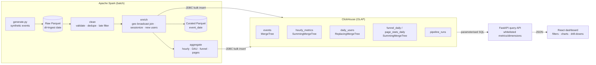

# SparkHouse

A batch analytics pipeline built on **Apache Spark** and **ClickHouse**. Spark cleans, enriches and
aggregates 100M+ clickstream events. The results go into a columnar ClickHouse store, so analytical
queries return in under a second. A **React** dashboard reads them through a small query API with
SQL-backed filters and drill-downs.

## What it does

1. **Generate**: a synthetic clickstream generator runs inside Spark (`spark.range` plus column
   expressions), so 100M+ events cost only cluster time. It lands Parquet partitioned by ingestion
   date and mixes in realistic noise: duplicate deliveries, null users, malformed event types,
   negative revenue, unknown countries and late arrivals.
2. **Clean**: normalises categorical fields, enforces the event contract, drops events that arrive
   more than 48h late, and dedupes by `event_id` (the earliest ingested copy wins).
3. **Enrich**: broadcast-joins a geo dimension (country to region), derives sessions from 30-minute
   inactivity gaps per user, and flags new users.
4. **Aggregate**: builds hourly additive metrics, daily active/new users, an ordered conversion
   funnel and per-page engagement. The funnel folds each user's time-sorted events with a
   higher-order `aggregate`, so steps only count when they happen in order.
5. **Load**: writes the detail table and the four aggregates to ClickHouse over JDBC in large
   batches. Every table is partitioned by `event_date`. Before inserting, the job drops the
   partitions for the days it processed, so reruns are idempotent. Each run is recorded in
   `pipeline_runs`.
6. **Serve**: a FastAPI service exposes read-only endpoints. Metrics and dimensions are checked
   against whitelists, and every filter value is bound as a ClickHouse server-side parameter. The
   browser never sends SQL.
7. **Explore**: the React dashboard shows KPI cards, a trend chart with hourly/daily granularity
   and series splits, region → country → device → event-type drill-down bars, the funnel, a
   top-pages table and a paginated raw-event table. You can click a page or a user to see their
   events.

## Architecture



### Data model

| Table | Engine | Grain | Used for |
|---|---|---|---|
| `events` | MergeTree, bloom index on `user_id` | one row per event | drill-down, exact/approx distinct users |
| `hourly_metrics` | SummingMergeTree | hour × event type × country/region × device | events, sessions, revenue trends and breakdowns |
| `daily_users` | ReplacingMergeTree | day × country × device | DAU / new users |
| `funnel_daily` | SummingMergeTree | day × country × device × step | conversion funnel |
| `page_stats_daily` | SummingMergeTree | day × page × country × device | top pages |
| `pipeline_runs` | MergeTree | one row per run | audit |

Distinct counts cannot be added up across groups. When a query needs active users under arbitrary
filters, the API runs `uniq(user_id)` on the `events` table. Additive metrics come from the much
smaller `hourly_metrics` table.

## Project layout

```
clickhouse/init/001_schema.sql   ClickHouse DDL (runs on first container start)
pipeline/sparkhouse/
  generate.py                    synthetic event generator (Spark)
  transform/{clean,enrich,aggregate}.py
  sink/clickhouse.py             JDBC writer + HTTP admin client (partition drops, audit)
  jobs/run_pipeline.py           end-to-end batch job CLI
pipeline/tests/                  local-mode Spark unit tests
api/app/                         FastAPI service (queries.py = SQL builders)
api/tests/                       query-builder and endpoint tests (no DB needed)
dashboard/                       React + TypeScript + Vite + Recharts
docker-compose.yml               ClickHouse, Spark master/worker, API, dashboard
```

## How to run

**Prerequisites:** Docker and Docker Compose, Python 3.9+, Java 17 (for local PySpark) and Node 20.
Running the full 100M-event set takes roughly 8+ GB of RAM for Spark and about 10 GB of disk.
The 10M default runs fine on a laptop.

```bash
cp .env.example .env            # set CLICKHOUSE_PASSWORD
docker compose up -d --build    # ClickHouse :8123, Spark UI :8080, API :8000, dashboard :3000

python -m venv .venv && source .venv/bin/activate
pip install -r pipeline/requirements.txt

# 1. generate raw events (EVENTS=100000000 for the full-scale run)
make generate EVENTS=10000000 START=2024-06-01 DAYS=30

# 2. run the pipeline locally and load ClickHouse (the JDBC driver is fetched via spark.jars.packages)
set -a; source .env; set +a
make pipeline START=2024-06-01 END=2024-06-30

#    ...or submit it to the dockerised Spark cluster instead
make pipeline-cluster START=2024-06-01 END=2024-06-30
```

Open the dashboard at http://localhost:3000. For hot reload during development:

```bash
cd api && pip install -r requirements.txt && uvicorn app.main:app --reload   # :8000
cd dashboard && npm install && npm run dev                                    # :5173, proxies /api
```

Useful pipeline flags: `--no-clickhouse` (transform only), `--no-curated`, and `--writers N` (the
number of concurrent insert streams). Rerunning a date range replaces those days. It never
duplicates them.

You can query ClickHouse directly:

```bash
docker compose exec clickhouse clickhouse-client -u sparkhouse --password change-me \
  -q "SELECT event_type, sum(events) FROM sparkhouse.hourly_metrics GROUP BY event_type"
```

## How to test

```bash
pip install -r pipeline/requirements.txt -r api/requirements.txt
make test            # runs both suites
make test-pipeline   # Spark transforms in local[2] mode (needs Java 17)
make test-api        # SQL builder + endpoint tests with a fake query runner, no ClickHouse needed
cd dashboard && npm run typecheck
```

The pipeline tests cover normalisation and validation, dedupe that keeps the earliest ingest,
late-event and date-window filtering, the geo join, gap-based sessionization, the new-user flag,
hourly/DAU/page aggregates and the ordered funnel (an out-of-order purchase is not counted). The API
tests confirm that values are always bound as parameters, that unknown identifiers are rejected
with a 400, and that metrics are routed to the right table.

## Configuration

All settings come from environment variables (see `.env.example`): ClickHouse host, port, database
and credentials, `SPARK_MASTER`, `SPARKHOUSE_DATA_DIR` and `CLICKHOUSE_JDBC_PACKAGE`. Do not commit
real credentials. `.env` is git-ignored.
